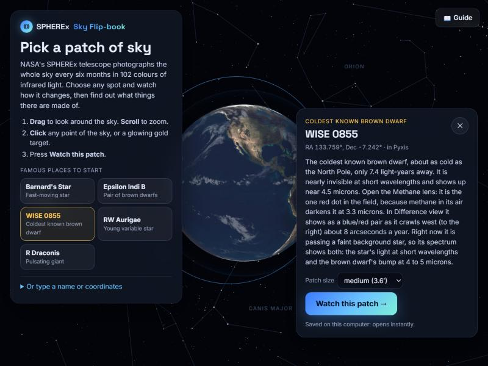
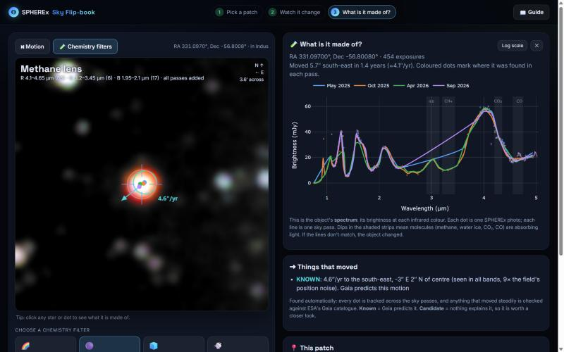

# SPHEREx Sky Flip-book

*Every pixel is a spectrum, every spectrum has a history.*

A NASA Space Apps 2026 (Haifa) project. NASA's SPHEREx telescope photographs the whole sky about every six months, in
102 infrared colours. This tool takes any position on the sky, fetches every SPHEREx photo of it from NASA's public
archive, and plays the sky passes as a **flip-book**, so that anything that **moved** or **changed brightness**
stands out. Click any object to see its spectrum in every pass.

What it adds on top of the pictures:

- **A fair comparison.** Every frame in a band covers the same wavelengths, so only real changes blink.
- **Help deciding what a thing is.** Automatic checks against Gaia, SIMBAD and the known asteroids; a "What is it?"
  reading of the spectrum using the published SPHEREx brown-dwarf templates; a guide to telling real objects from
  camera artefacts; a report a volunteer can save.
- **Planetary defence.** Known asteroids and comets that crossed the patch are named, and for near-Earth objects the
  tool shows NASA/JPL's own published impact-risk information. It never computes a risk of its own.
- **A longer history.** Older photos of the same spot from NASA's WISE (2010) and from Canada's NEOSSat are added to
  the timeline, so slow movers can be followed over 16 years.
- **A game.** "Spot the mover" trains new volunteers on patches where the answer is known.

Everything runs on your own computer. The data comes straight from the public archives; no account or key is needed.

## How to run it (Windows)

### First time

1. **Install Python.** Go to https://www.python.org/downloads/ and download Python 3.12 (or newer).
   Run the installer and, on its first screen, **tick "Add python.exe to PATH"** before clicking *Install Now*.
2. **Download this project.** On the project's GitHub page, click the green **Code** button, then
   **Download ZIP**. Right-click the downloaded ZIP, choose **Extract All…**, and put the folder somewhere
   easy, such as your Desktop. (If you use Git, `git clone` works too.)
3. **Start it.** Open the folder and double-click **start.bat**. The first time, it sets up Python's add-ons
   for this project (a private folder called `.venv`); this takes a few minutes and needs internet.
   After that it says "Ready!" and opens your browser.
   - If Windows shows "Windows protected your PC", click **More info**, then **Run anyway**.
   - If it says Python can't be found, reinstall Python and make sure "Add python.exe to PATH" is ticked.

The showcase targets (the five NASA test targets, plus Luhman 16, Kapteyn's Star, M82, Barnard 68, the asteroid Eros and the comet 3I/ATLAS) open straight away: their stacked pictures are included. The single photos behind them
(needed for spectra, lenses and the mover search) are not included, to keep the download small; the first time
you open one, the tool fetches them from NASA in the background (2 to 4 minutes per target). Clicking for a
spectrum during that time just waits until they are in.

To fetch them all up front instead, double-click **download_photos.bat** (about 4 to 15 minutes; safe to run again,
it skips photos you already have). Any new sky position you type in the app is downloaded from NASA automatically.

### Every time

1. Open the `spherex-sky-tool` folder.
2. Double-click **start.bat**. A black window opens; after a few seconds it says "Ready!" and your browser opens
   at http://127.0.0.1:8000. If the tool is already running, it just opens the browser.
3. Keep the black window open while you use the tool. Close it to stop.

The tool runs only on your computer; it sends nothing anywhere except its requests to the public archives.

## What you can do

A full plain-language guide is built into the app: click **📖 Guide** at the top right (or open http://127.0.0.1:8000/guide.html).

| Feature | How |
|---|---|
| **Guided tour** | Click one of the five NASA test targets (top right). They are saved on your computer, so they open instantly. |
| **Any position** | Type `269.4464 4.7686`, `17 57 47.1 +04 46 07`, or a name like `RW Aur`, then press **Show**. The first visit to a spot downloads every SPHEREx image of it (2 to 4 minutes); after that it opens instantly. |
| **Field of view** | 2.4′, 3.6′, 6′ or 9′. Bigger shows more sky (good for fast movers) but downloads more. |
| **Fair flip-book** | One picture per ~6-month sky pass, per detector (wavelength band). Every frame in a band covers the same wavelengths, so only real changes blink. |
| **Blink controls** | Play/pause (space bar), step (arrow keys), speed, brightness, faint-star lift, blink all passes or just first ↔ last. |
| **Difference views** | *Difference*: each pass minus the average (red = brighter, blue = fainter; a mover is a red/blue pair). *Change since first pass*. *All passes added*: the deepest picture. Press **d** to toggle. |
| **Click for spectrum** | Click any object. You get its brightness at every wavelength in every exposure, one curve per sky pass, with molecule bands marked. The measurement *follows* moving objects pass by pass, and reports how far and which way they moved. |
| **Molecule lenses** | False-colour views from chosen wavelength windows: Infrared colour, Methane, Water ice, CO₂/CO. Ordinary stars come out white; anything coloured has unusual chemistry. WISE 0855 and Epsilon Indi B (brown dwarfs) come out red in the Methane lens. |
| **Automatic mover search** | Runs on every position. Finds every point of light in each pass, links them, flags anything that moved steadily well beyond the field's own wobble, and checks it against Gaia: *known* (Gaia predicts it) or *candidate* (nothing explains it). Arrows on the picture (4x longer than the real motion so they're visible). On the tour: Barnard's Star and Epsilon Indi B come out *known*; WISE 0855 (not in Gaia) comes out as a *candidate*, found with no hint; RW Aurigae and R Draconis show no movers. Search code: `spx/movers.py`. |
| **Gaia overlay** | Circles where ESA's Gaia catalogue predicts each star on the date of each pass (proper motion + parallax). Fast movers get a dashed path. Press **g** to toggle. |
| **Problem flags** | Tint pixels the archive flagged (saturation, cosmic rays, ghosts, satellite streaks, bad pixels, afterimages) in the pass on screen. |
| **Exposure list** | Under "This position": every exposure in the frame on screen, with its date, detector and the wavelength it saw here. |
| **Share / save** | *Copy share link* (the link reopens the exact view: position, field, band, mode, lens, Gaia), *Save picture* (PNG), *Save animation* (GIF). |

### Links you can type or embed

`http://localhost:8000/?ra=331.097&dec=-56.8008&field=0.06&band=6&view=diff&gaia=1`

Parameters: `ra`, `dec` (degrees), `field` (degrees: 0.04, 0.06, 0.1, 0.15), `band` (0 = all, 1-6 = detector),
`view` (`normal`, `diff`, `first`, `stack`), `mode=lens` with `lens` (`color`, `methane`, `ice`, `co2`), `gaia=1`.

## Data and references

### Data (all public, no account needed)

| Source | What we use it for | Credit |
|---|---|---|
| **NASA SPHEREx** spectral images (data release 1 and quick release 3) | The main data: every photo in the flip-book, every spectrum | NASA / JPL-Caltech / SPHEREx Science Team, served by the NASA/IPAC Infrared Science Archive (IRSA), https://irsa.ipac.caltech.edu |
| **NASA WISE / AllWISE** images | The 2010 frame of each patch | NASA / JPL-Caltech / UCLA, served by IRSA (Wright et al. 2010, AJ 140, 1868) |
| **NEOSSat** images | Extra frames where Canada's satellite looked; the 3I/ATLAS showcase | NEOSSat is a mission of the **Canadian Space Agency**. Images from the **Canadian Astronomy Data Centre** (CADC), operated by the National Research Council of Canada with the support of the Canadian Space Agency, https://www.cadc-ccda.hia-iha.nrc-cnrc.gc.ca |
| **Gaia DR3** | Predicted star positions per pass, known fast movers, matching NEOSSat photos to the sky | European Space Agency (ESA) and the Gaia Data Processing and Analysis Consortium (Gaia Collaboration, Vallenari et al. 2023, A&A 674, A1), https://gea.esac.esa.int |
| **SIMBAD** and the **Sesame** name service | Names and types of known objects, name-to-position lookup | CDS, Strasbourg, France (Wenger et al. 2000, A&AS 143, 9); SIMBAD mirror at the Harvard-Smithsonian CfA |
| **SkyBoT** | Which known asteroids and comets were in each photo | IMCCE, Observatoire de Paris (Berthier et al. 2006, ASP Conf. Ser. 351, 367), https://ssp.imcce.fr |
| **JPL Small-Body Database, Sentry, Close-Approach Data, Horizons** | Published orbit class, impact-risk and close-approach information; positions of comets and asteroids | NASA / JPL Solar System Dynamics, https://ssd.jpl.nasa.gov and https://ssd-api.jpl.nasa.gov |
| **SPHEREx ultracool-dwarf standard templates** (24 templates, types M8 to Y1) | The "What is it?" match for brown dwarfs. A copy is in `spx/templates/` | Gagné et al. 2026, data on Zenodo, https://doi.org/10.5281/zenodo.19051216 |
| Star and constellation lists for the 3D sky picker (`web/vendor/sky/*.json`) | Drawing the sky around the Earth | d3-celestial by Olaf Frohn (BSD 3-Clause), https://github.com/ofrohn/d3-celestial |
| Earth day, night-lights and cloud pictures (`web/vendor/sky/earth_*`) | The globe in the picker | From the three.js examples; based on NASA Blue Marble / Earth Observatory imagery |

The app also offers links out to other public viewers (WiseView from Backyard Worlds, Legacy Survey, Aladin Lite,
SIMBAD, the Minor Planet Center). Nothing is taken from them.

Catalogues of known objects that the volunteer can switch on (each fetched only when asked for, then kept):

| Catalogue | Fetched from | Reference |
|---|---|---|
| **CatWISE2020** (infrared, with motions) | NASA/IPAC IRSA; NOIRLab Astro Data Lab when IRSA is busy | Marocco et al. 2021, ApJS 253, 8 |
| **2MASS** point sources | VizieR (CDS) mirror at the Harvard-Smithsonian CfA; IRSA as fallback | Skrutskie et al. 2006, AJ 131, 1163 |
| **Pan-STARRS1** mean objects | MAST at the Space Telescope Science Institute | Chambers et al. 2016, arXiv:1612.05560 |
| **SkyMapper DR2** | SkyMapper archive, Australian National University | Onken et al. 2019, PASA 36, e033 |
| **SIMBAD** objects in the patch | SIMBAD (CDS), CfA mirror | Wenger et al. 2000 |

### Open-source software

- Python 3.12 with **Astropy** (Astropy Collaboration 2022, ApJ 935, 167), **NumPy**, **SciPy**, **Matplotlib**,
  **Pillow**, **Requests**, **FastAPI** and **Uvicorn** (see `requirements.txt`).
- In the browser: **Plotly.js** 2.35.2 (MIT) for the spectrum plot and **three.js** with OrbitControls (MIT) for the
  3D picker, both stored in `web/vendor/`; the fonts Inter and Space Grotesk (SIL Open Font License) from Google Fonts.

## Use of AI

The code, the in-app guide and this README were written with **Claude**, Anthropic's AI model (through Claude Code),
under the team's direction. The team chose the idea and the features, decided what to build and what not to, and
tried the tool on known objects. No AI is used inside the tool itself: the mover search, the spectrum matching and
all checks are ordinary, explainable calculations, and no images or data are AI-generated. Every picture and number
comes from the archives listed above.

## Things to know (honest limits)

- **Very bright stars are burnt out (saturated)** in SPHEREx: Barnard's Star, RW Aurigae and R Draconis. Their pictures
  and motion look fine. For their spectra the tool automatically measures the star's *outer glow* (a ring 18–37″ out,
  which is not saturated), the same way in every exposure, and says so. These numbers are not total brightness, but
  passes can be compared. Check on Barnard's Star (which should not change): its glow agrees between passes to about
  5–10% at most wavelengths, up to ~25% at the shortest ones (the star's blur shape differs a little by season).
  R Draconis fades by about half at 1 µm across the three passes, far more than that. A proper fix is to fit the
  star-shape model shipped in each file (the EPSF layer we currently skip downloading).
- **Name lookups** give a catalogue position for the year 2000; the tool moves it forward to 2026 using the object's
  known motion. Typed-in coordinates are used as they are, so for a fast mover type its present-day position.
- **Spectrum brightness** is measured in a 12″ circle with the sky around it removed. It is right for comparing passes
  and wavelengths, but not a calibrated total brightness (some light falls outside the circle, more at long wavelengths).
- **Lens colours** are balanced so typical stars are white, using the stars in that field. In a field with few stars the
  balance is rougher.
- If NASA's archive is busy, a request can fail; just press **Show** again. Results that came from a partial archive
  answer are not kept, so the next visit tries again.

## What is where

| File | Job |
|---|---|
| `download_photos.bat`, `scripts/download_photos.py` | Download all NASA photos for the tour targets (or any position) ahead of time. |
| `start.bat`, `scripts/launch.py` | One-click start: sets up Python packages on first run, waits until the tool is ready, then opens the browser. |
| `server/app.py` | The small local web server the page talks to. |
| `web/index.html`, `web/app.js`, `web/style.css` | The page: search, player, lenses, spectrum plot, overlays. `web/picker.js`, `web/sky.js`: the 3D picker. `web/asteroids.js`, `web/tools.js`, `web/game.js`, `web/zoom.js`: asteroid panel, volunteer tools, game, zoom. `web/vendor/plotly.min.js` draws the spectrum plot (stored locally so it works offline). |
| `spx/flipbook.py` | The whole chain for one position: find images, download, stack per pass and band, package. |
| `spx/analysis.py` | On-demand extras: spectra, lenses, problem-flag maps, Gaia predictions, mover search. |
| `spx/movers.py` | Blind mover search. |
| `spx/asteroids.py`, `spx/other_telescopes.py`, `spx/objcheck.py`, `spx/board.py` | Known asteroids and NASA risk data; WISE and NEOSSat frames; checks, "What is it?" and reports; game boards. |
| `spx/archive.py` | Talks to NASA's IRSA archive (SIA search, cutout downloads with retries). |
| `spx/frames.py` | Cleans each image (bad pixels, sky glow), groups by sky pass, stacks per detector. |
| `spx/resolve.py` | Names and coordinates to positions, moved forward for proper motion. |
| `spx/tour.py`, `scripts/prebuild.py` | The showcase targets, and the script that downloads them ahead of time (`.venv\Scripts\python scripts\prebuild.py`). |
| `spx/wave_tables/` | Each detector's wavelength map (fixed hardware calibration), stored once. |
| `spx/astrometry.py`, `scripts/barnard_demo.py` | Star position measurement and the Barnard's Star proof from the first step. |
| `data/` | Everything downloaded and computed, per position. Safe to delete; it will be downloaded again when needed. |

## Technical notes

### How the download was made small and reliable

1. **Image-layers-only download** (`archive._stream_image_layers`): each cutout file is ~4 MB, almost all of it a
   star-shape table (EPSF) we don't use yet. We stream the file and stop at the first table, keeping IMAGE, FLAGS,
   VARIANCE and ZODI (~130 KB). About 30x less data; a whole target is ~45 MB instead of ~1.4 GB.
2. **Stored wavelength tables** (`frames._wave_table`, `spx/wave_tables/D1-6.fits`): the WCS-WAVE table that maps
   detector pixel to wavelength is identical in every file of a detector, so it is stored once and attached to the
   slimmed files.
3. **Archive robustness**: "Server busy" replies are retried; if one data release fails to answer, the others are used
   and the incomplete list is not cached.
4. **Spectra that follow movers** (`analysis._follow`): per pass, the object is re-found in that pass's stack before
   measuring, so Barnard's Star or WISE 0855 are measured where they are, not where they were.
5. **Name lookup with motion** (`resolve.py`): CDS Sesame plus proper motion, moved from the year 2000 (SIMBAD's
   position date) to 2026.2. Note: the WISE 0855 coordinates in the challenge text (08h55m10.831s −07°14′42.53″) are
   from around 2014; by 2026 it has moved about 1.6′ west, outside a small field centred on those numbers. The tour
   uses its 2026 position.
6. **Windows file locking**: cutouts are read without memory-mapping so cached files can be deleted while the
   server runs.

### Fairness and quality checks

- **Same wavelength mix in every pass.** Each detector's range is cut into 6 narrow slices; each slice is stacked on
  its own and a frame is the plain average of the slices every well-covered pass has. Passes that miss slices or have
  too few photos are left out of the blink or labelled "limited comparison". "All colours" says how many detectors it
  averaged (only those fairly comparable in every pass).
- **No invented pixels.** Only small holes fully surrounded by data (burnt-out star centres) are filled; anything else
  stays "no data" and is drawn hatched.
- **One-off glitches thrown out.** Within a pass and detector, a pixel far brighter than all other photos agree on
  (cosmic ray, satellite glint, afterimage) is discarded before stacking. This removed a "blob" that showed up near
  WISE 0855 in May 2026: it came from 1 of 99 photos (flagged TRANSIENT) plus 2 afterimages (flagged PERSIST); no known
  asteroid was there (checked with IMCCE SkyBoT).
- **Honest completeness.** A result is saved as complete only if every listed photo was downloaded and read; otherwise
  missing photos are retried on the next visit. Saved results carry a version number and build date and are rebuilt
  when the stacking method changes.
- **Spectra use the wavelength at the clicked spot**, follow movers, mark one-off bad photos, and separate
  "burnt-out centre" from "off the edge".
- **Automatic checks:** `.venv\Scripts\python scripts\self_test.py` (constant star stays constant, missing data is not
  filled, glitches removed, RA wrap, steady field star within 5%, Barnard's Star and Eps Indi B found as known movers,
  WISE 0855 found as a candidate, no false movers on RW Aur and R Dra).

Not done yet: a "check NASA for newer photos" button (saved results do record their date), and passes are still split
by 60-day gaps (fine for SPHEREx's real schedule; an unusual observing pattern could merge passes).

### Volunteer tools, other telescopes and the game

| Feature | Where | Code |
|---|---|---|
| **Older photos from other telescopes**: NASA WISE 2010 on every patch; Canada's NEOSSat wherever it looked. Extra, dashed timeline frames; never used in brightness comparisons. | "🛰 Older photos" chip | `spx/other_telescopes.py`, `analysis.other_frames` |
| **NEOSSat star-matching**: archive photos have no precise sky coordinates, so each is matched to Gaia stars (rotation, flip and shift found by voting, then a least-squares fit) before stacking. | automatic | `other_telescopes._solve` |
| **"What is it?"**: plain-language reading of the spectrum's shape (ordinary star / cool star / cold brown dwarf / dusty), with confidence and reasons. Rule-of-thumb, not a classification. | top of the spectrum panel | `spx/objcheck.what_is_it` |
| **Automatic checks**: Gaia match, SIMBAD name (also at the year-2000 position for fast movers), known asteroids over the spot, measured motion, **partner star** moving the same way within 0.5 deg. | spectrum panel | `spx/objcheck.checks` |
| **Report**: name for credit + note + all check results, saved to `reports/` and Downloads, or copied as text. Local only (no shared server yet). | "📝 Report this object" | `objcheck.save_report` |
| **Single photos** behind any clicked spot. | "📷 Single photos" | `analysis.single_photo` |
| **Computer's picks**: movers, brightness changes (same sign in 3+ detectors), unusually red objects. Hidden until asked when exploring freely; one-by-one yes/no mode. | "💡 Computer's picks" | `analysis.picks` |
| **Practice mode**: 5 rounds on saved targets with known answers. | first screen | `web/tools.js` |
| **Known asteroids + NASA risk info**; **follow a moving object** (re-centre every photo on a comet/asteroid using JPL Horizons, then stack). | ☄ panel; `scripts/follow_object.py` | `spx/asteroids.py` |
| Zoom, inverted colours, tame bright stars, links to WiseView / Legacy Survey / SIMBAD / Aladin, keyboard shortcuts. | "More controls", spectrum panel | `web/tools.js` |

Checks: `scripts/self_test.py` runs 31 checks in all (these include: brown-dwarf reading, partner star, ordinary star reading,
picks flag a variable star as "changed" not "moved", quiet field gives no picks).

"What is it?" matches the spectrum against the 24 published SPHEREx standard templates (M8 to Y1) and against
plain star curves; if no template fits clearly better, it falls back to simple rules about the spectrum's shape.

**The game and the boards** (`web/game.js`, `spx/board.py`): five rounds on patches with known answers, up to 1,000
points a round, a daily challenge, ranks, an explorer count and a confirmed-discoveries board. Real searching is
never marked right or wrong. Scores are kept on this computer only.

**Catalogue chooser and scan banner** (`spx/catalogs.py`, `web/catalogs.js`): the volunteer picks which catalogues
of known objects to use (Gaia, CatWISE, 2MASS, Pan-STARRS, SkyMapper, SIMBAD), each with its own colour. "Known" and
"unexplained" always refer to the catalogues switched on, and the tool says which were checked. Catalogues with
motions are moved to the date of the picture; old catalogues without motions are only trusted when the object's
earlier position can be worked out to within 10″. A banner above the picture says plainly whether the computer's
scan is still running, found something, or found no candidates.

**Zoom on the picture** (`web/zoom.js`): mouse wheel or pinch, drag to move, double-click.

Not done yet: a shared server for reports and boards; the full per-object brown-dwarf library (only the 24 templates
are used).
